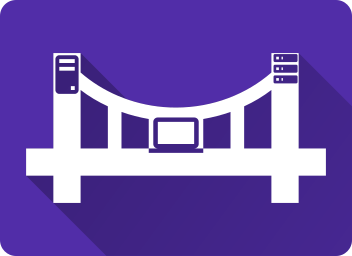

# ha-pc-card

  &nbsp;&nbsp;
  &nbsp;&nbsp;
  

A Lovelace card for **PCs and Macs**: their state, CPU, GPU, RAM and disks, the signed-in user, and buttons to wake, lock, sleep or shut them down (with a confirmation).

> [!NOTE]
> This card is being designed: there is no release yet. Watch the repository to know when the first version is out.

| Card | Type | What it shows |
|---|---|---|
| PC | `custom:pc-card` | A computer's state, CPU, GPU, RAM and disks, the signed-in user, and its wake, lock, sleep and shutdown buttons. |
| PC mini | `custom:pc-mini-card` | The computer's state and load on two lines, with a zoom to the full card. |

## Supported integrations

The card reads the sensors and controls of these integrations:

| | Integration | What the cards show |
|:---:|---|---|
|  | [System Bridge](https://www.home-assistant.io/integrations/system_bridge/) (built in) | Windows and Linux: CPU, GPU, memory, disks, power actions |
|  | [HASS.Agent](https://github.com/hass-agent/HASS.Agent-Integration) (Marketplace) | Windows: sensors, commands and notifications |
|  | [LNXlink](https://github.com/bkbilly/lnxlink) (MQTT) | Linux: sensors and controls through MQTT discovery |
|  | [Mobile App (macOS)](https://www.home-assistant.io/integrations/mobile_app/) (built in) | The Home Assistant macOS app's sensors |
|  | [Wake on LAN](https://www.home-assistant.io/integrations/wake_on_lan/) (built in) | Turn the computer on |

## Installation

### Via the Marketplace (recommended)

Click the button below to add the repository directly:

Or manually:

1. Open **Settings → Marketplace → Add from link** (top right; this needs a GitHub account connected)
2. Add `https://github.com/juju35/ha-pc-card` — Type: **Dashboard**
3. Open **PC Card** and click **Install**
4. Clear your browser cache and refresh

The Marketplace registers the dashboard resource for you.

### Manual

1. Download `ha-pc-card.js` and the `ha-pc-card.i18n.*.js` translation files from the [latest release](https://github.com/juju35/ha-pc-card/releases/latest)
2. Copy them all to `/config/www/` (without the translation files, the cards show in English)
3. Go to **Settings → Dashboards → Resources** → Add resource:
   - URL: `/local/ha-pc-card.js`
   - Type: **JavaScript Module**
4. Clear your browser cache and refresh

## License

[MIT](https://github.com/juju35/ha-pc-card/blob/main/LICENSE)

## Support

If you find this project useful, you can support its development:

