# ha-pc-card

[](https://www.home-assistant.io/integrations/marketplace/)
[](https://github.com/juju35/ha-pc-card/actions/workflows/hacs.yml)
[](https://github.com/juju35/ha-pc-card/actions/workflows/validate.yml)
[](https://github.com/juju35/ha-pc-card/actions/workflows/lint.yml)
[](https://github.com/juju35/ha-pc-card/releases/latest)
[](https://github.com/juju35/ha-pc-card/blob/main/LICENSE)
[](https://buymeacoffee.com/julienstep9)

<p align="center"></p>

<p align="center">
  &nbsp;&nbsp;
  &nbsp;&nbsp;
  
</p>

A Lovelace card for **PCs and Macs**: their state, CPU, GPU, RAM and disks, the signed-in user, and buttons to wake, lock, sleep or shut them down (with a confirmation).

[](https://my.home-assistant.io/redirect/marketplace_repository/?owner=juju35&repository=ha-pc-card&category=plugin)

| Card | Type | What it shows |
|---|---|---|
| [PC](#screenshots) | `custom:pc-card` | A computer's state, CPU, GPU, RAM and disks, the signed-in user, and its wake, lock, sleep and shutdown buttons. |
| [PC mini](#pc-mini) | `custom:pc-mini-card` | The computer's state and load on two lines, with a zoom to the full card. |

| On | Shut down, confirmed |
|---|---|
| 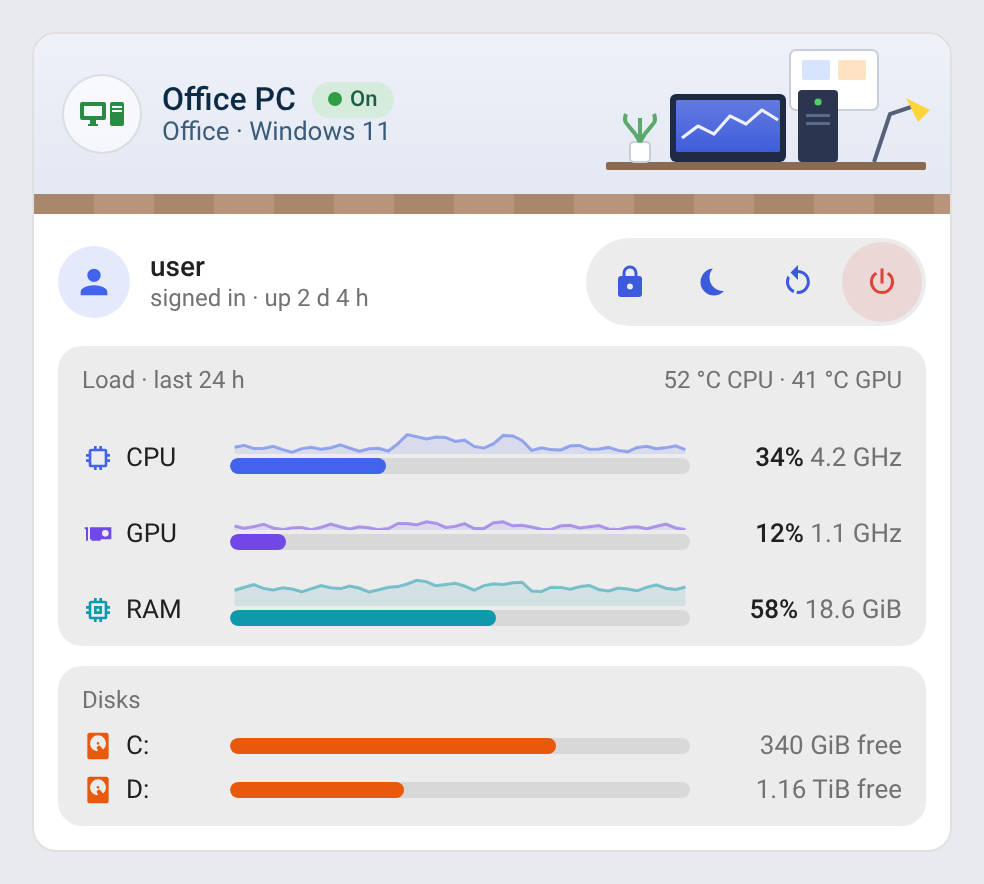 | 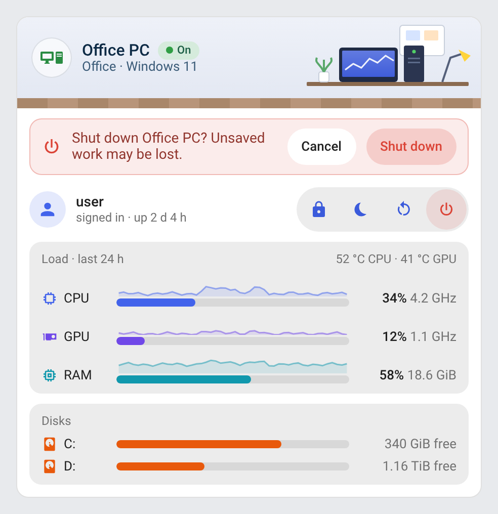 |

## Features

- **The computer's state**: on, locked, asleep or off, from its online sensor, its session or power state sensor, or its loads; the badge, the status pill and the illustration follow it
- **The session**: the signed-in user and the uptime (from the boot time); asleep or off, since when
- **CPU, GPU and RAM**: a bar each with its last 24 hours drawn behind it (from the recorder, on a 0–100 scale), the clock in GHz and the memory used in GiB, the CPU and GPU temperatures above
- **Disks**: a bar per disk with its free space, in base 1024 (GiB, TiB)
- **Controls**: lock, sleep, restart and shut down as round buttons; sleep, restart and shut down ask first, at the top of the card (`confirm: false` runs them at once); off or asleep, a wake button (its button or switch, else Wake on LAN with `mac`)
- **Illustrated header**: a desk with the monitor and the tower; on, a chart scrolls on the screen and the light is green; locked, a padlock; asleep, the moon on a dark screen and an amber light that breathes; off, both dark; the dark theme darkens the room and lights the lamp
- **Mini card**: the CPU load as a ring around the badge, the state, the CPU and the RAM as chips; its zoom button opens the full card in place
- **Tap a bar** to open its sensor's history
- Visual editor for both cards, light and dark themes, 22 languages, no external dependency

## Supported integrations

The card reads the sensors and controls of these integrations:

| | Integration | What the cards show |
|:---:|---|---|
|  | [System Bridge](https://www.home-assistant.io/integrations/system_bridge/) (built in) | Windows and Linux: CPU, GPU, memory, disks, power actions |
|  | [HASS.Agent](https://github.com/hass-agent/HASS.Agent-Integration) (Marketplace) | Windows: sensors, commands and notifications |
|  | [LNXlink](https://github.com/bkbilly/lnxlink) (MQTT) | Linux: sensors and controls through MQTT discovery |
|  | [Mobile App (macOS)](https://www.home-assistant.io/integrations/mobile_app/) (built in) | The Home Assistant macOS app's sensors |
|  | [Wake on LAN](https://www.home-assistant.io/integrations/wake_on_lan/) (built in) | Turn the computer on |

## Installation

### Via the Marketplace (recommended)

Click the button below to add the repository directly:

[](https://my.home-assistant.io/redirect/marketplace_repository/?owner=juju35&repository=ha-pc-card&category=plugin)

Or manually:

1. Open **Settings → Marketplace → Add from link** (top right; this needs a GitHub account connected)
2. Add `https://github.com/juju35/ha-pc-card` — Type: **Dashboard**
3. Open **PC Card** and click **Install**
4. Clear your browser cache and refresh

The Marketplace registers the dashboard resource for you.

### Manual

1. Download `ha-pc-card.js` and the `ha-pc-card.i18n.*.js` translation files from the [latest release](https://github.com/juju35/ha-pc-card/releases/latest)
2. Copy them all to `/config/www/` (without the translation files, the cards show in English)
3. Go to **Settings → Dashboards → Resources** → Add resource:
   - URL: `/local/ha-pc-card.js`
   - Type: **JavaScript Module**
4. Clear your browser cache and refresh

## Configuration

Every option is in the visual editor. In YAML:

```yaml
type: custom:pc-card
entity: sensor.office_pc_cpu_load

# A computer with no wake button: Wake on LAN
type: custom:pc-card
entity: sensor.office_pc_cpu_load
mac: "AA:BB:CC:DD:EE:FF"
broadcast_address: 192.168.1.255

# Two lines on a phone dashboard
type: custom:pc-mini-card
entity: sensor.office_pc_cpu_load

# Roles the discovery missed, and the disks to show
type: custom:pc-card
entity: sensor.office_pc_cpu_load
entities:
  shutdown: script.office_pc_shutdown
  disks:
    - sensor.office_pc_disk_c_usage
```

| Option | Type | Default | Description |
|---|---|---|---|
| `entity` | string | the first computer found | Any entity of the computer's device; its other entities are found on the same device |
| `device` | string | | Advanced (YAML only): a device id, when `entity` is not set |
| `title` | string | the device's name | Card title |
| `show_title` | boolean | `true` | Both: show the title |
| `show_subtitle` | boolean | `true` | Both: the area and the model (or version) under the title |
| `navigation_path` | string | | Both: a tap on the header opens this dashboard path |
| `mac` | string | | The computer's MAC address, to wake it with Wake on LAN when it has no wake button or switch |
| `broadcast_address` | string | | The broadcast address for Wake on LAN |
| `show_history` | boolean | `true` | The last 24 hours behind the bars |
| `show_disks` | boolean | `true` | The disks |
| `show_controls` | boolean | `true` | Lock, sleep, restart, shut down and wake |
| `confirm` | boolean | `true` | Ask before sleep, restart and shut down |
| `illustration` | boolean | `true` | Both: the illustrated header (`false`: the classic header) |
| `illustration_theme` | string | `auto` | Both: `auto` (follows the Home Assistant theme: night with a dark theme, day with a light theme), `day` or `night` |
| `animations` | boolean | `true` | Both: the chart on the screen and the breathing light |
| `zoom` | boolean | `true` | Mini card: the zoom button |
| `entities` | map | | Advanced (YAML only): the entity of a role, over the discovery — `cpu`, `cpu_temp`, `cpu_speed`, `gpu`, `gpu_temp`, `gpu_speed`, `ram`, `ram_used`, `user`, `uptime`, `online`, `state`, `lock`, `sleep`, `shutdown`, `restart`, `wake` (a `button`, `script` or `switch`), and `disks` (a list of usage sensors in %) |
| `language` | string | Home Assistant's | Advanced: one of the [languages](#translations) |

## Screenshots

| On | Locked | Shut down, confirmed |
|---|---|---|
|  | 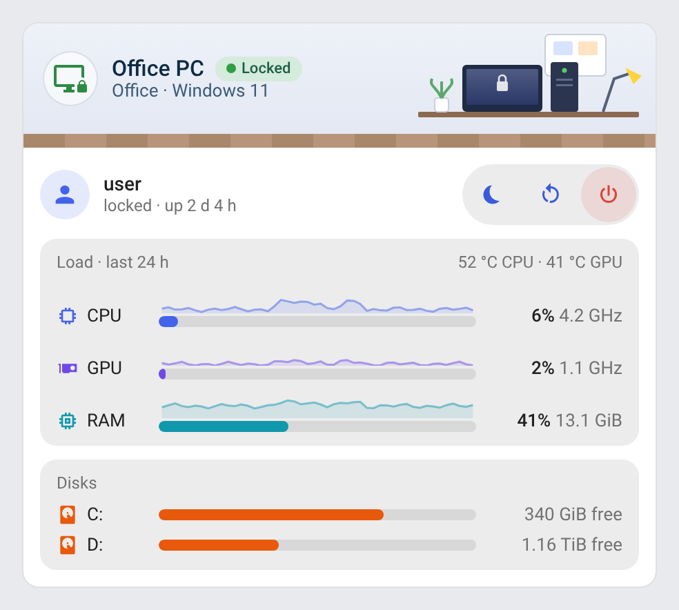 |  |
| 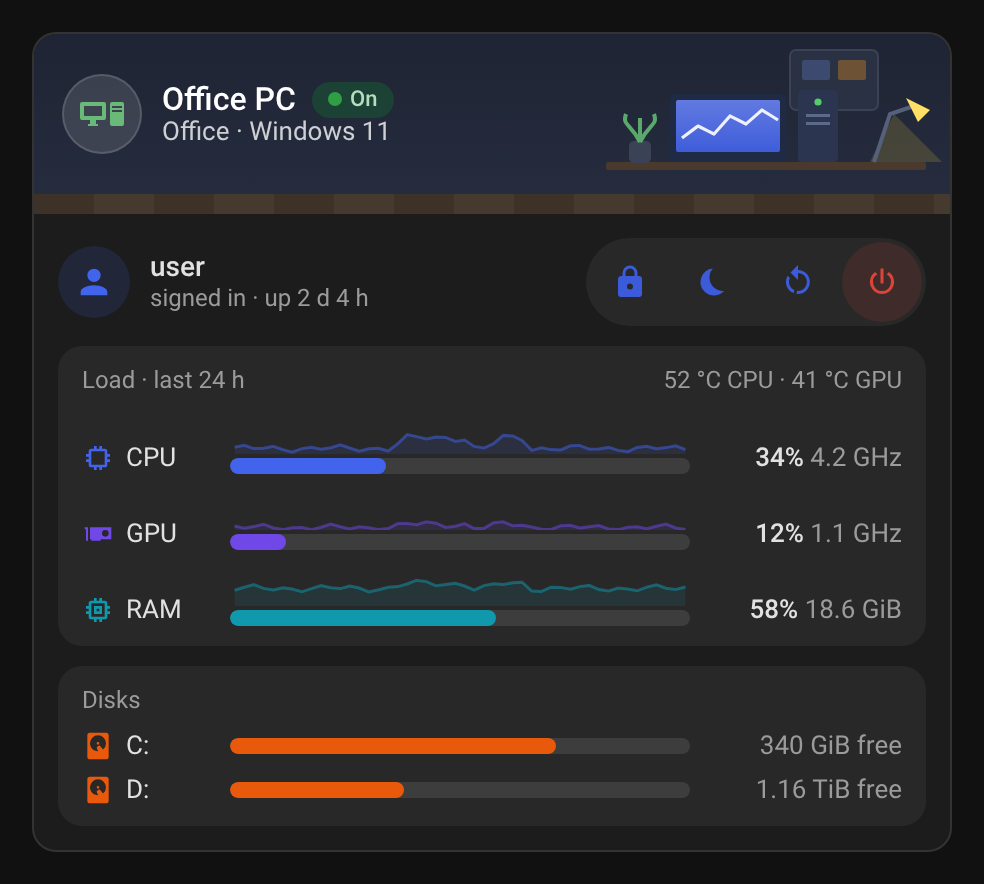 | 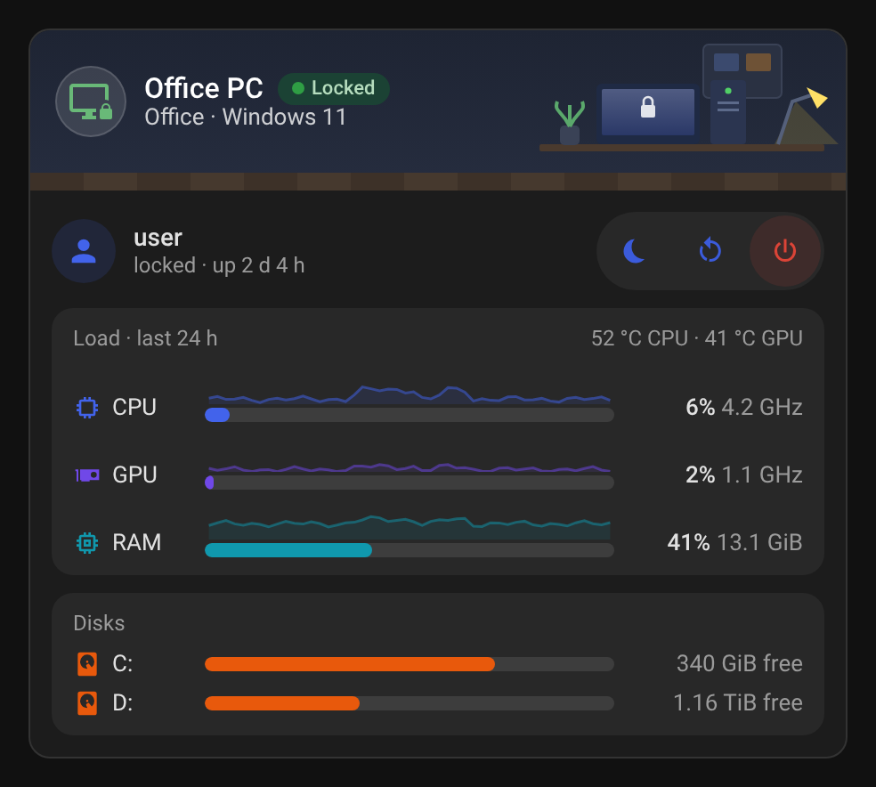 | 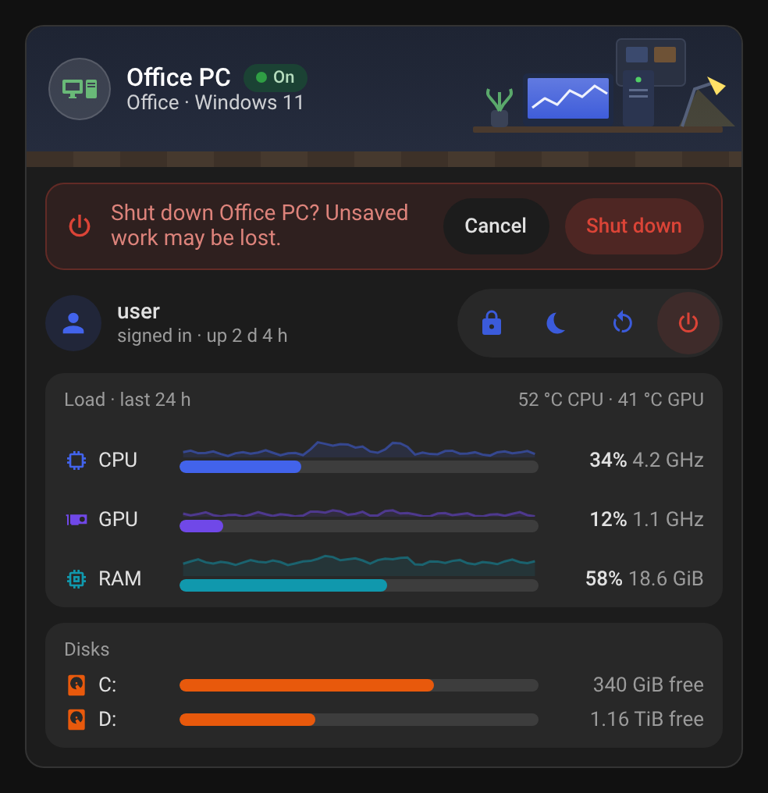 |

| Asleep | Off | Narrow |
|---|---|---|
| 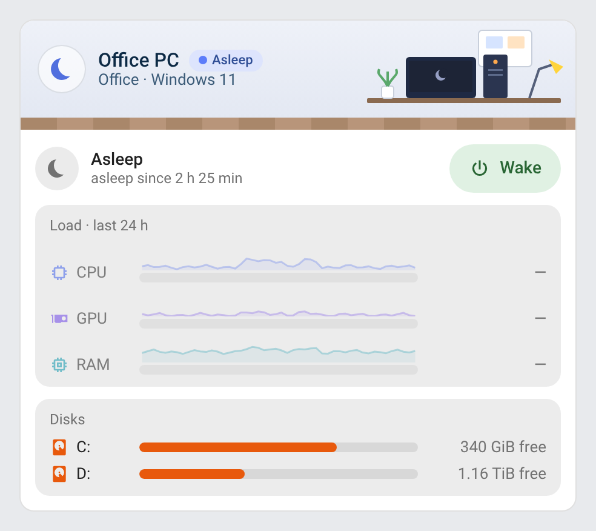 | 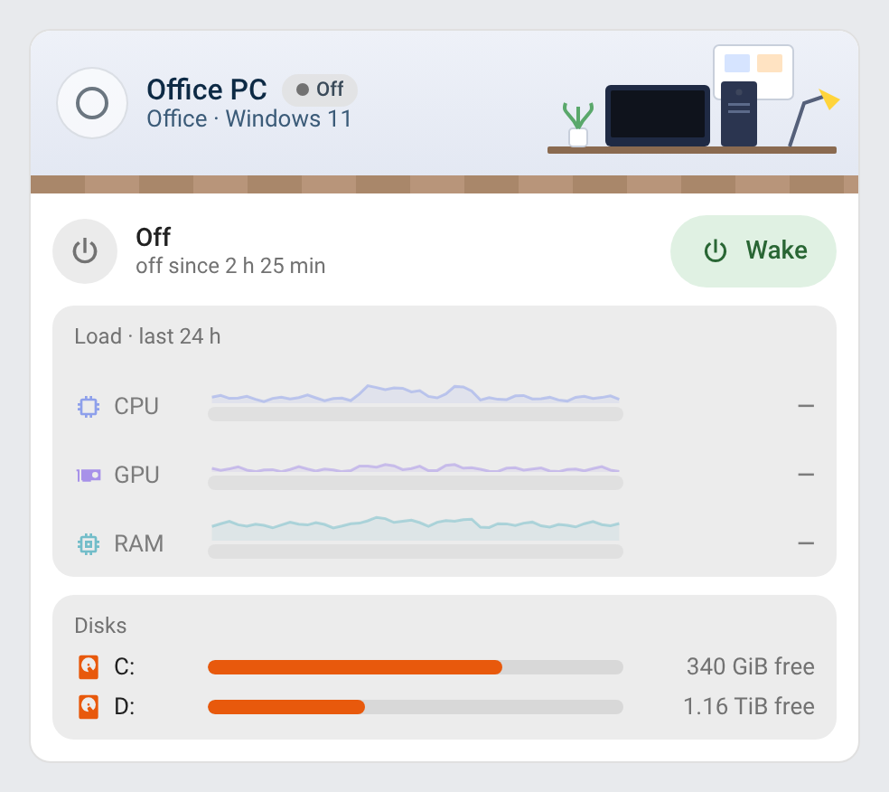 | 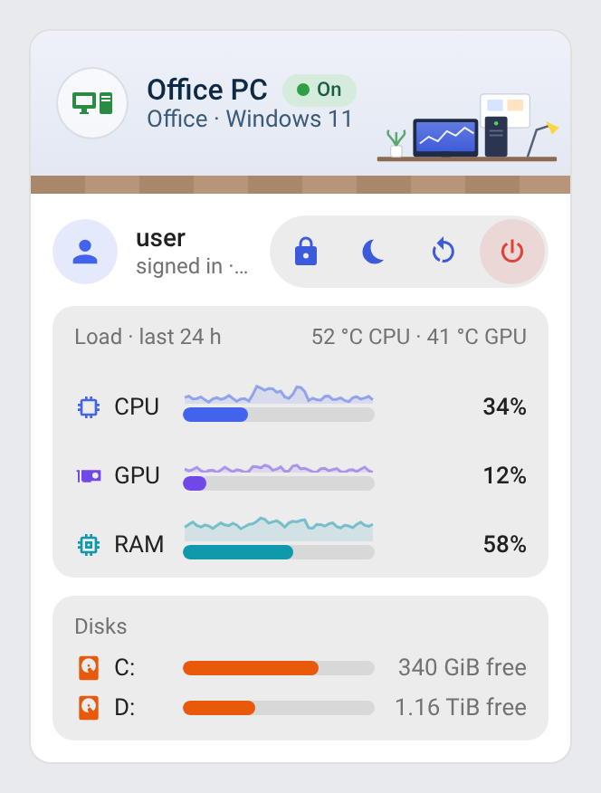 |
|  | 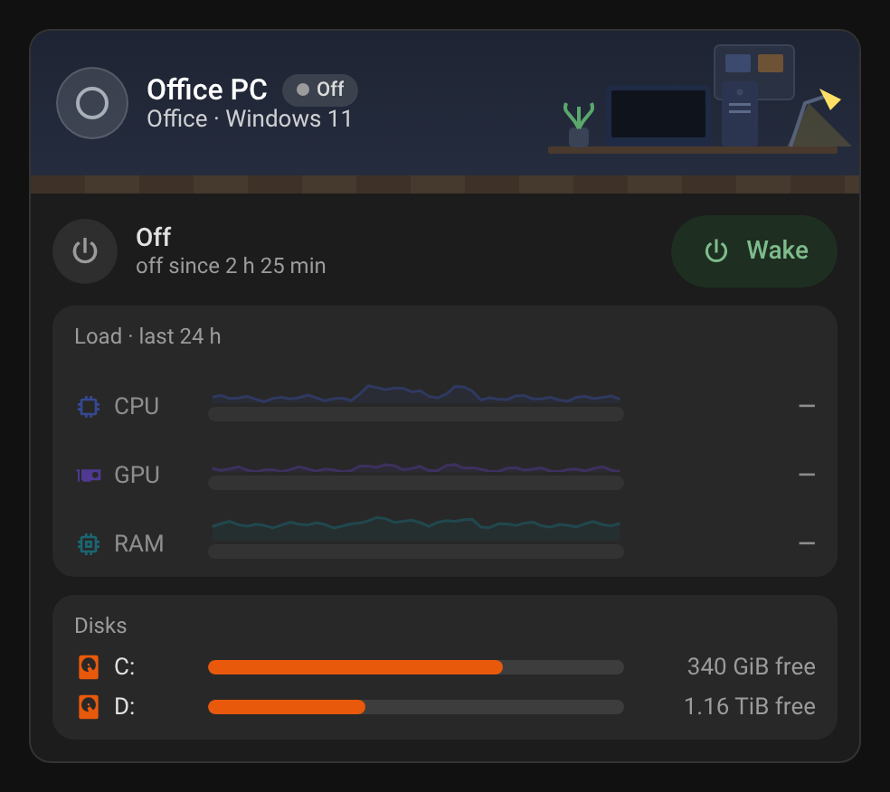 | 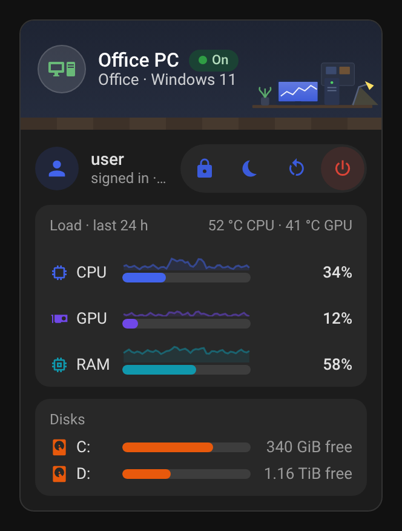 |

**On**: a chart scrolls on the monitor and the tower's light is green. **Asleep**: the moon on a dark screen, the tower's light breathes amber (still with `animations: false`, or when the system asks for reduced motion).

| On | On, dark | Asleep | Asleep, dark |
|---|---|---|---|
| 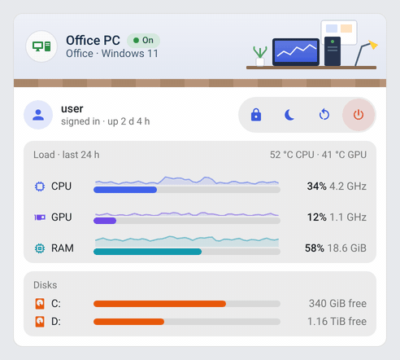 |  | 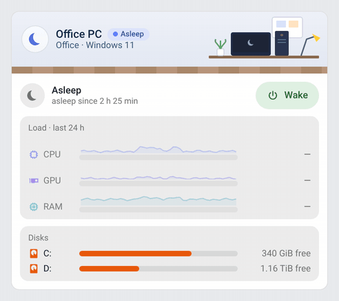 | 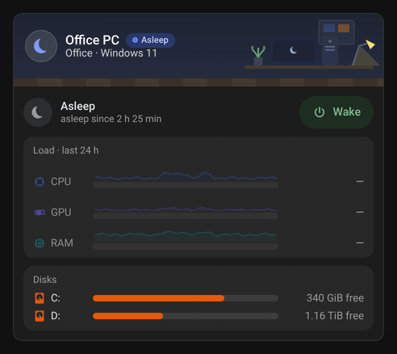 |

### PC mini

| On | Asleep | Zoomed in |
|---|---|---|
| 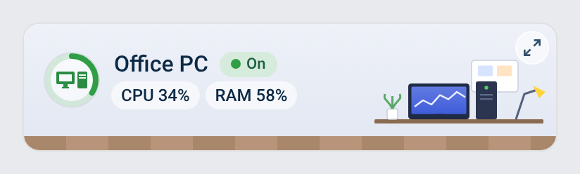 | 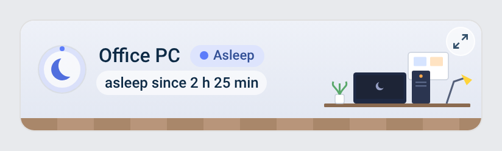 | 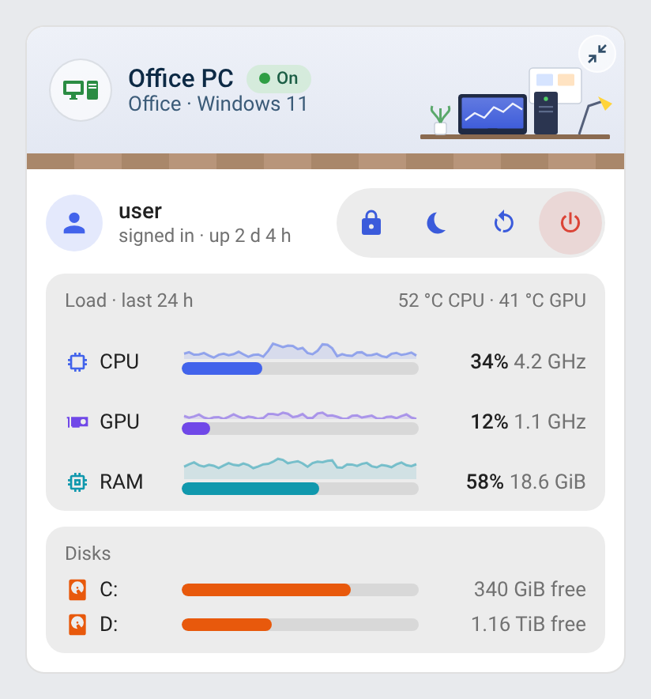 |
| 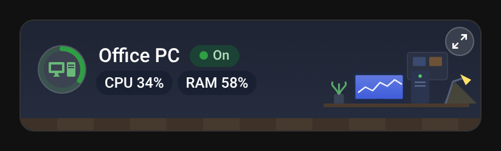 | 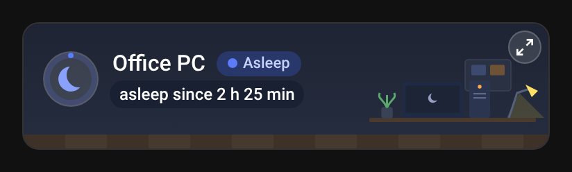 | 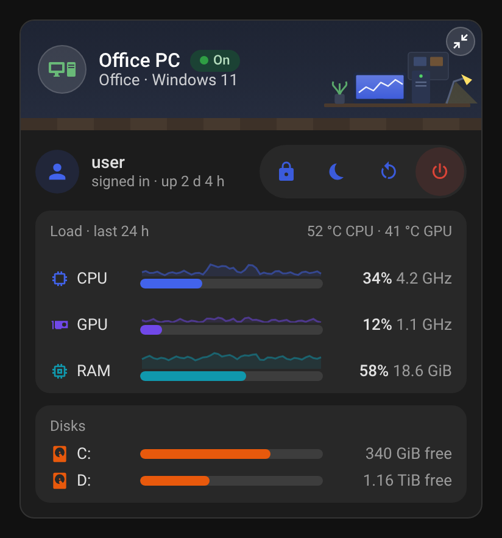 |

## How it works

- **Computer**: `entity`'s device (or `device`), else the device of System Bridge, HASS.Agent, MQTT (LNXlink) or Mobile App with the most PC roles
- **Roles**, on that device, by domain, device class, unit and name: `cpu`, `gpu` and `ram` (sensors in %), `cpu_speed` and `gpu_speed` (MHz or GHz), `cpu_temp` and `gpu_temp` (temperatures), `ram_used` (a data size named *used*), `uptime` (a boot time timestamp), `user` (the active or logged-in user), `online` (a connectivity, power or running binary sensor), `state` (a session or power state sensor: *sleep*, *suspend*, *locked*, *off*…), and the buttons, scripts or switches `lock`, `sleep`, `restart`, `shutdown` and `wake`; `entities` sets any of them
- **Disks**: the sensors in % named after a disk, drive, volume or partition, each with the free space sensor of the same drive letter or name
- **State**: asleep or off from the state sensor, off when the online sensor is off, on (or locked) when the online sensor is on or a load reports; off otherwise
- **Last 24 hours**: `history/history_during_period` for the three loads, averaged in 48 slots of 30 minutes, fetched at first and every 10 minutes
- **Actions**: `button.press` (or `script.turn_on`, a switch's `turn_off` / `turn_on` for wake) on the role's entity, and `wake_on_lan.send_magic_packet` with `mac`; nothing else

## Development

```bash
npm install
npm run build        # stamps the version of package.json into dist/ha-pc-card.js
npm run check        # builds and checks the bundle (run in CI)
npm test             # unit tests
npm run screenshots  # renders the cards with a mock computer into screenshots/ (and the GIFs, needs ffmpeg)
```

The source is split into ES modules under `src/pc-card/` (entry `src/pc-card/index.js`), `src/shared/` (entry `src/shared/index.js`); `npm run build` assembles them (`scripts/bundle.mjs`) into the single file the Marketplace serves.

`dist/` is not committed: `npm run build` creates it locally, CI builds it on every push, and the release workflow attaches the built files to the release, which is where the Marketplace installs them from.

### Releasing

1. Bump `version` in `package.json`
2. Add a `## <version>` section at the top of [CHANGELOG.md](https://github.com/juju35/ha-pc-card/blob/main/CHANGELOG.md)
3. Push to `main`: the **Release** workflow builds the card, creates the tag and the GitHub release with the changelog section as notes, and attaches `ha-pc-card.js` and its translation files

## Translations

The card auto-detects the language from your Home Assistant settings. Currently supported:

| Language | Code |
|---|---|
| English | `en` |
| Français | `fr` |
| Deutsch | `de` |
| Español | `es` |
| Српски | `sr` |
| Srpski (latinica) | `sr-Latn` |
| Italiano | `it` |
| Nederlands | `nl` |
| Português (Portugal) | `pt` |
| Polski | `pl` |
| Română | `ro` |
| Dansk | `da` |
| Svenska | `sv` |
| Български | `bg` |
| Русский | `ru` |
| Українська | `uk` |
| Magyar | `hu` |
| Slovenčina | `sk` |
| Čeština | `cs` |
| Slovenščina | `sl` |
| Latviešu | `lv` |
| Ελληνικά | `el` |

Contributions for additional languages are welcome!

## License

[MIT](https://github.com/juju35/ha-pc-card/blob/main/LICENSE)

## Support

If you find this project useful, you can support its development:

<a href="https://buymeacoffee.com/julienstep9"></a>
